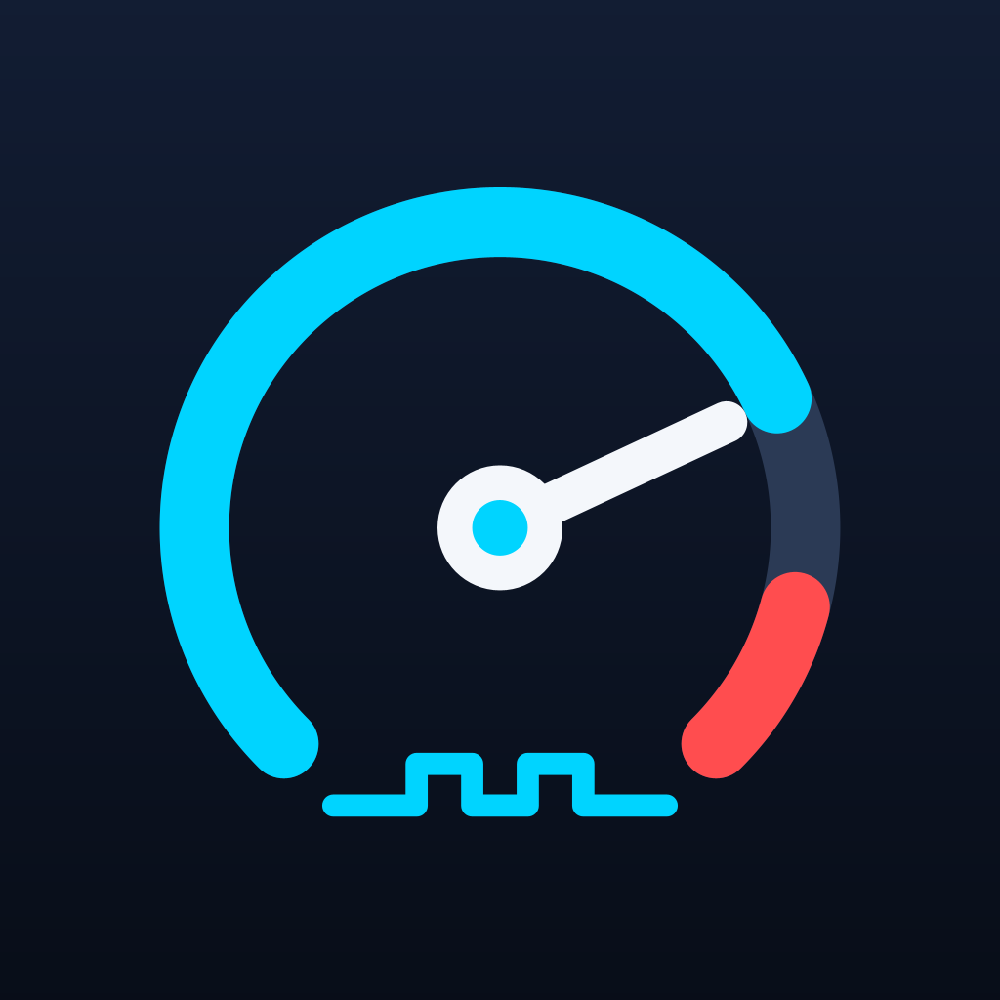

# K-line Logger (iOS)

A SwiftUI iOS app for live data and diagnostics from Kawasaki personal watercraft, built around a Veepeak OBDCheck Wi-Fi (ELM327) adapter. It drives the same Kawasaki KWP2000-over-K-line dialect as the Windows app in this repo (`StartCommunication`, `StartDiagnosticSession`, `ReadDataByLocalIdentifier`), but through the ELM327's AT-command interface over Wi-Fi instead of a raw K-line serial cable.

Not affiliated with or endorsed by Kawasaki.

## Requirements

- Xcode 16+, iOS 18.1+
- A Veepeak OBDCheck Wi-Fi adapter (or compatible ELM327 Wi-Fi adapter) connected to the ski's 4-pin diagnostic port
- Your phone joined to the adapter's Wi-Fi network (e.g. "OBDCHECK") before connecting in-app

## Features

- **Connect** — joins the adapter over Wi-Fi (`192.168.0.10:35000`), negotiates the K-line session, and shows the raw AT-command handshake log for troubleshooting.
- **Live Data** — radial gauges for RPM and GPS speed, plus cards for every enabled channel in the channel list (throttle, intake pressure, temps, battery). A Speed Comparison card tracks two unconfirmed "might be the paddlewheel sensor" PIDs alongside real GPS speed.
- **PID Scanner** — sweeps every local identifier (0x00-0xFF), shows which respond with their raw bytes, and supports a Watch mode (select PIDs, see live values + low/high) for identifying unknown sensors. Results export as a text report.
- **Demo Mode** — simulated data for trying the UI without hardware.
- **Research Logging** (developer setting, off by default) — logs every known channel, GPS speed, and chosen unknown PIDs together once per second, exportable as CSV, for correlating unknown PIDs with real sensor behavior. Intended for extending the shared channel list to other Kawasaki models.

## Project structure

| Path | What it is |
|---|---|
| `KlineLogger/` | App source (SwiftUI views, `WiFiOBDManager` protocol/session logic, `FormulaEvaluator`, `PIDDefinition`) |
| `KlineLogger.xcodeproj` | Xcode project |
| `KlineLoggerTests/`, `KlineLoggerUITests/` | Test targets |

## Known PIDs

The built-in channels come from [`../shared/channels/kawasaki.json`](../shared/channels/kawasaki.json), the same file the Windows and Android apps use. The Xcode project adds that folder to the app target, so an edit there reaches all three apps. See [`../shared/README.md`](../shared/README.md).

## Protocol notes

See the root [README](../README.md#protocol-notes) for the full KWP2000 frame format. The iOS app doesn't construct frames by hand — it sets the ELM327's header via `ATSH`, sends bare service bytes (e.g. `21 09` for `ReadDataByLocalIdentifier`), and lets the adapter handle wake-up timing, framing, and checksums.
